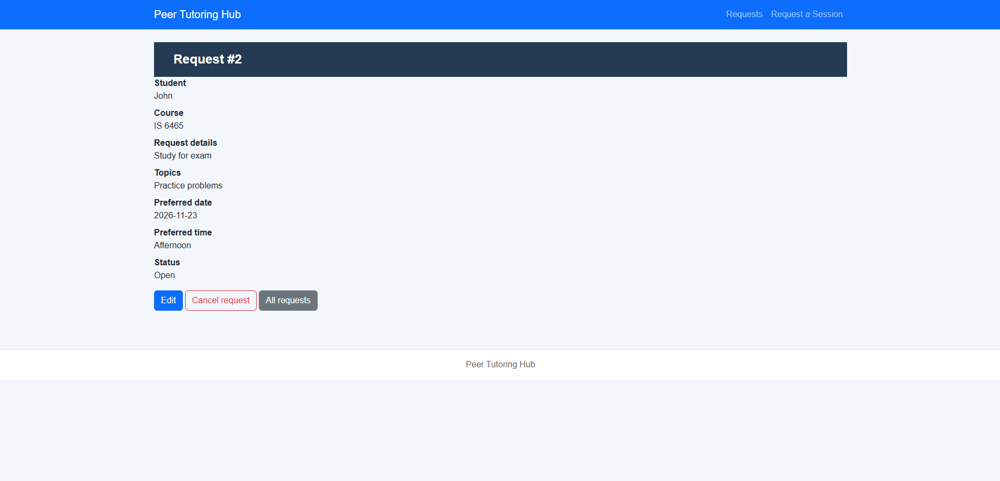

I ran .tables to see the present tables and confirmed that students and tutoring_requests were both present
This is the url it opened https://sturdy-parakeet-vgqxgxp69jr2xp5r-8000.app.github.dev/php/request-form.php
My request was saved and displayed

| Test | Expected Result | Actual Result | Pass or Fail
| ----- | ------ | ------ | ------ |
| Submit a valid request | A  new tutoring request is created with status open | Essentially did this for part 2. It displayed my new request with status open | Pass |
| View all requests | The new request appears in the request list | New request appears in the list | Pass |
| Filter Requests | Filtering by course or status shows matchign requests | Filtered properly by class and status | Pass |
| Edit an Open Request | The revised values are displayed | Updated details and topics, both updated properly and were displayed with their changed values | Pass |
| Cancel an Open Request | The request status changes to cancelled | Cancelled a new request I made. Request properly updated to cancelled | Pass |
| Try to edit or cancel a cancelled request | The application does not allow the change | I cannot edit the request I cancelled for the last step | Pass |

Questions for part 4
1. php/request-form.php
2. php/process-request.php
3. config/db.php
4. services/requestService.php
5. repositories/studentPDO.php also some in setup-database.sql, but just for creating the initial tables.
6. students
7. tutoring_requests
8. Through a foreign key relationship where the student_id column in the tutoring_requests table references the primary key student_id in the studnets 
Keeping SQL statements inside dedicated repository files (studentPDO.php and requestPDO.php) separates database logic from the user interface and HTML presentation in php/request-form.php. This layered architecture centralizes prepared statements to guard against SQL injection and makes queries much easier to maintain, reuse across different services, and test independently without altering form code

^C@isaacju26 ➜ /workspaces/lab6 (main) $ php tests/integration-tests.php
Xdebug: [Step Debug] Could not connect to debugging client. Tried: localhost:9003 (through xdebug.client_host/xdebug.client_port).
PASS UC01 create and Open
PASS Lab 4 checkbox values preserved
FAIL Duplicate email reuses student
FAIL UC02 course and status filter
PASS Invalid reason rejected
FAIL Invalid submission writes nothing
PASS Edit Open request
PASS Updated reason persisted
PASS Cancel Open request
PASS Cancelled row retained
PASS Second cancellation rejected
PASS Unrelated request unchanged
PASS FK enforced
PASS UC02 empty filter result
FAILURES: 3

I used Gemini for part 6
Prompt: Explain how a tutoring request moves from php/request-form.php through PHP, PDO, and SQLite in this project. Identify the responsibility of each file.
Answer: When a student submits a tutoring request in the Peer Tutoring Hub application, the data flows through a layered architecture that separates presentation, business logic, and database persistence:

php/request-form.php (Presentation / Form View): Renders the HTML form where the user enters their name, email, course, topic, preferred date, and preferred time, and submits it via HTTP POST to php/process-request.php.

php/process-request.php (Request Handler / Controller): Receives the $_POST submission, initializes the database connection, passes the raw input array to the service layer, and redirects the user to php/request-details.php on success (or back to the form with validation errors on failure).

config/db.php (Database Connection): Creates and configures the PDO instance pointing to database/tutoring.db with exception error handling enabled (PDO::ATTR_ERRMODE => PDO::ERRMODE_EXCEPTION).

includes/validation.php (Input Validation): Validates required fields, email formatting, and date/time constraints before any database writes occur.

services/requestService.php (Service / Transaction Coordinator): Coordinates input validation and wraps the multi-table write inside a PDO transaction (beginTransaction(), commit(), rollBack()). It ensures the student record exists (or creates one) and then creates the tutoring request linked to that student's ID.

repositories/studentPDO.php & repositories/requestPDO.php (Data Access Repositories): Execute parameterized SQL SELECT and INSERT statements using PDO prepared statements to find/insert rows in students and insert the new request with status Open into tutoring_requests.

database/tutoring.db (SQLite Storage): Persists the committed rows across the students and tutoring_requests tables linked via the student_id foreign key.

The AI accurately stated that services/requestService.php coordinates validation and wraps the database operations in a PDO transaction across both studentPDO.php and requestPDO.php. Checking the actual files confirms that php/process-request.php delegates form handling to services/requestService.php, which calls validation functions from includes/validation.php and executes prepared SQL statements through the two repository classes rather than placing raw SQL inside the controller or form view.

Prompt: Trace the requirement “a student can submit a tutoring request” through the PHP files, service, repositories, SQLite tables, and integration tests in this project.

Response: The requirement “a student can submit a tutoring request” is implemented end-to-end across five layers of the application:

User Interface & Controller: php/request-form.php collects the student and session fields and posts them to php/process-request.php, which forwards the submission and redirects to php/request-details.php upon creation.

Validation & Service Layer: includes/validation.php enforces field rules (non-empty strings, valid email, valid date/time), while services/requestService.php manages the transaction—looking up or inserting the student record first, retrieving student_id, and saving the tutoring request with a default status of Open.

Repository & SQL Layer: repositories/studentPDO.php queries and inserts into students, and repositories/requestPDO.php executes the parameterized INSERT INTO tutoring_requests query.

Database Schema: database/setup-database.sql defines students (student_id, student_name, student_email) and tutoring_requests (request_id, student_id, course, topic, preferred_date, preferred_time, status).

Automated Verification: tests/validation-tests.php verifies that invalid submissions are rejected, and tests/integration-tests.php exercises the service and repository layers end-to-end against SQLite to confirm a valid request is persisted with Open status and retrievable by ID.

The join in the query combines rows from the tutoring_requests table and students table into a single set whereever the conditions match. 